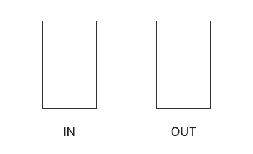

# 摊还分析 · Amortized Analysis

## 1. 动态数组 · Dynamic Array / Vector

数组 $A[n]$ 占 $O(n)$ space。插入时，满则申请 $2n$ 空间并 copy。

单次扩容 $\Theta(n)$，但 $m$ 次插入的总代价：

$$
T(m)=m+3c(1+2+4+\cdots+2^{\lfloor\log_2m\rfloor})
\le m+3c\cdot 2m\le 7cm.
$$

有：

$$
\frac{T(m)}m\le 7c=O(1).
$$

## 2. 双栈队列 · Two-stack Queue

两个栈：IN、OUT。



Enqueue 时放入 IN；dequeue 时优先取 OUT，若 OUT 为空，则将 IN 全部倒入 OUT 再取出。

**伪代码实现如下**

```text
enqueue(x):
1. IN.push(x)

dequeue():
1. if OUT is not empty
2.     return OUT.pop()
3. else
4.     while IN is not empty
5.         x = IN.pop()
6.         OUT.push(x)
7.     return OUT.pop()
```

Enqueue 最坏 $O(1)$；dequeue 单次最坏 $\Theta(n)$。

### 2.1 记账法 · Accounting Method

设将一个元素从 IN 搬到 OUT 的总成本为 $c$；enqueue 预存 $c$ credit，搬运时使用。

| 操作 | Actual cost | Credit 变化 | Amortized cost |
| :--- | :--- | :--- | :--- |
| Enqueue | $c$ | $+c$ | $2c$ |
| Dequeue，搬运 $t$ 个元素 | $ct+c$ | $-ct$ | $c$ |

每个元素只搬运一次，累计 credit 始终非负：

$$
\sum\operatorname{actual\ cost}\le\sum\operatorname{amortized\ cost}.
$$

因此，$m$ 次操作总代价为 $O(m)$，每次摊还 $O(1)$。

> **关键**
>
> 分析操作序列的总代价，不是只看某一次操作的 worst case。

## 3. 支持删除的动态数组

容量为 $n$，元素数为 $\mathrm{num}$：

- $\mathrm{num}=n$ 时，扩至 $2n$。
- $\mathrm{num}=n/4$ 时，缩至 $n/2$。

设 $e$ 为扩、缩容时搬运的元素数：

| 操作 | Actual cost | Credit 变化 | Amortized cost |
| :--- | :--- | :--- | :--- |
| Ins，不扩容 | $c$ | $6c$ | $7c$ |
| Ins，扩容 | $c+3ce$ | $6c-3ce$ | $7c$ |
| Del，不缩容 | $c$ | $3c$ | $4c$ |
| Del，缩容 | $c+3ce$ | $3c-3ce$ | $4c$ |

**扩容**：从 $\mathrm{num}=n/2$ 到 $n$，需要 $n/2$ 次插入，平均需预存：

$$
\mathrm{credit}=\frac{3n}{n/2}\,c=6c.
$$

**缩容**：从 $\mathrm{num}=n/2$ 到 $n/4$，需要 $n/4$ 次删除，平均需预存：

$$
\mathrm{credit}=\frac{3n/4}{n/4}\,c=3c.
$$

两种 resize 完成后，装载率均回到 $1/2$：扩容后为 $n/(2n)$，缩容后为 $(n/4)/(n/2)$。因此从 $\mathrm{num}=n/2$ 开始分别计算扩、缩所需的 credit。

累计 credit 非负，插入、删除的摊还复杂度均为 $O(1)$。
