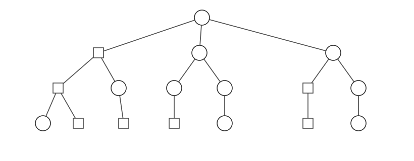
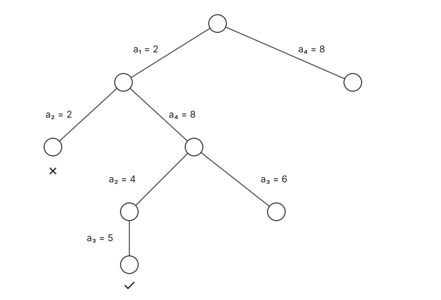

# 回溯 · Backtracking

## 1. 深度优先搜索与剪枝

$\circ$ 为 good，$\square$ 为 bad。是否存在从 root 到 leaf 的 good path？



| | DFS | BFS |
| :--- | :--- | :--- |
| Time | Best $O(h)$，worst $O(n)$ | Worst $O(n)$ |
| Space | $O(h)$ | $O(w)$，$w$ 为最大层宽 |

遇到 bad 节点即停止向下搜索：

$$
\operatorname{backtracking}=\operatorname{DFS}+\operatorname{pruning}\text{（剪枝）}.
$$

**伪代码实现如下**

```text
dfs(u):
1. if u is bad
2.     return 0
3. if u is a leaf
4.     return 1
5. else
6.     for each child v of u
7.         if dfs(v)
8.             return 1
9. return 0
```

还可以扩展为：找一条 good path / 统计 good paths 数量 / 找出全部 good paths。

## 2. N 皇后 · N Queens

$P[i]$ 为第 $i$ 行皇后所在的列，下标从 $0$ 开始。每行尝试下一列，失败则退回上一行。

候选列 $j$ 不能攻击之前的皇后，即对所有 $0\le k<i$：

$$
j\ne P[k],\qquad |j-P[k]|\ne i-k.
$$

**循环写法**

```text
NQ(n):
1.  P[j] = -1 for j = 0, ..., n - 1
2.  i = 0
3.  while i >= 0 and i < n:
4.      findfeasible = false
5.      for j = P[i] + 1 to n - 1:
6.          if j cannot attack P[0], ..., P[i - 1]
7.              P[i] = j
8.              findfeasible = true
9.              break
10.     if findfeasible
11.         i = i + 1
12.     else
13.         P[i] = -1
14.         i = i - 1
15. if i == -1
16.     no feasible solution
17. if i == n
18.     return P[0], ..., P[n - 1]
```

解数记作 $(cn)^n$ 量级，枚举所有解还需逐个输出：

$$
\#\mathrm{solutions}\approx(cn)^n,\qquad
T_{\mathrm{all}}\approx(cn)^n\operatorname{poly}(n).
$$

## 3. 距离重建 · Turnpike

### 3.1 距离多重集

$D(A)$ 为点集 $A$ 中所有点对距离构成的 multiset，保留重复次数：

$$
A=\{0,1,4\}\Rightarrow D(A)=\{1,3,4\},
$$

$$
A=\{0,0,2\}\Rightarrow D(A)=\{0,2,2\},\qquad
|D(A)|=\frac{|A|(|A|-1)}2.
$$

Input：距离多重集 $D$。Output：点坐标多重集 $A$，使得 $D(A)=D$；坐标也允许有重数。

例：

$$
D=\{1,2,2,2,3,3,4,4,5,5,6,6,8,8,10\},\quad n=6.
$$

固定 $a_0=0$、$a_5=10$。

### 3.2 关键观察与回溯

> **关键**
>
> 剩余距离中的最大值 $d$，一定涉及左端点 $a_0$ 或右端点 $a_{n-1}$。

因此新点只需尝试 $d$ 或 $a_{\max}-d$。



先令 $A=\{0,\max(D)\}$，从 $D$ 删除一次 $\max(D)$，再调用 TP(D,A)。

**伪代码实现如下**

```text
TP(D, A):
1.  if D is empty
2.      return 1
3.  d = max(D)
4.  for a* in {d, a_max - d}:
5.      Delta = {|a* - a| : a in A}
6.      if Delta is a sub-multiset of D
7.          D' = D - Delta
8.          A' = A union {a*}
9.          if TP(D', A')
10.             return 1
11. return 0
```

$\Delta\subseteq D$ 与 $D-\Delta$ 均按多重集重数处理。

$$
T_{\mathrm{worst}}=O(2^n\cdot n\log n).
$$

固定两端点、区间内随机取 $n-2$ 个点时，average cost 为 $O(n^2\log n)$。

### 3.3 多项式表示

若坐标为整数、最大坐标为 $N$，可考虑 $\operatorname{poly}(nN)$ 时间的表示与处理。

$$
A+B=\{a+b:a\in A,b\in B\}.
$$

例：$A=\{1,2,3\}$、$B=\{4,5,6\}$，令：

$$
F_A(x)=x+x^2+x^3,\qquad F_B(x)=x^4+x^5+x^6.
$$

有：

$$
F_A(x)F_B(x)=x^5+2x^6+3x^7+2x^8+x^9.
$$

按集合去重后，$A+B=\{5,6,7,8,9\}$；若保留全部 $|A||B|$ 次配对，则多重集为 $\{5,6,6,7,7,7,8,8,9\}$。

若直接枚举两组各 $n$ 个元素的和，需要 $O(n^2)$。当 $A,B$ 中最大整数为 $N$ 时，可改为计算多项式乘法。

指数表示和，系数表示重数；FFT 计算耗时 $O(N\log N)$。

对距离多重集，令：

$$
F_A(x)=\sum_{a\in A}x^a,\qquad F_D(x)=\sum_{d\in D(A)}x^d.
$$

有：

$$
F_A(x)F_A(x^{-1})=F_D(x)+F_D(x^{-1})+n.
$$

对应有序差 $A-A$：

$$
A-A=\underbrace{\{0,\ldots,0\}}_{n\text{ 个自身差}}
\uplus D(A)\uplus\bigl(-D(A)\bigr).
$$

$\uplus$ 表示多重集并；若坐标有重复，点对之间的 $0$ 距离仍保留在 $D(A)$ 中。$F_A(x^{-1})=\sum_{a\in A}x^{-a}$，相乘即枚举所有有序差。

对应有序差 $A-A$：$n$ 个自身差 $0$，以及正、负距离，重数均保留。

后续转为多项式分解。
