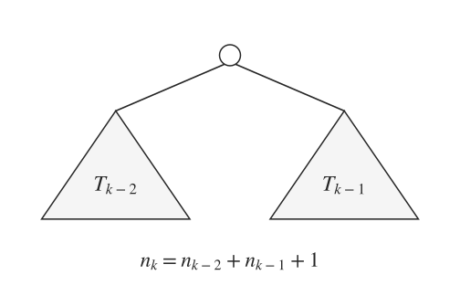
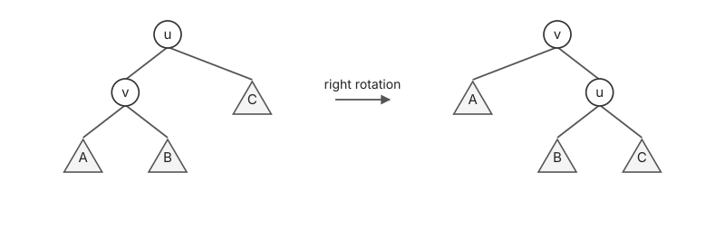
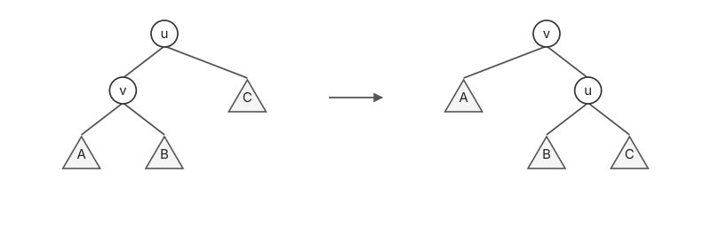
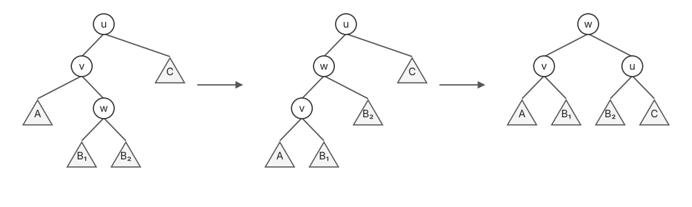

# AVL 树 · AVL Tree

## 1. 平衡条件与树高

对节点 $u$，左右子树高度分别为 $h_L,h_R$：

$$
|h_L-h_R|\le 1.
$$

每个节点均 balanced，则整棵树为 AVL tree。

设 $T_k$ 为高度为 $k$、节点数最少的 AVL 树，节点数为 $n_k$：

$$
\begin{cases}
n_0=0,\quad n_1=1,\\
n_k=n_{k-2}+n_{k-1}+1.
\end{cases}
$$

左右子树分别取 $T_{k-2}$、$T_{k-1}$。令 $\varphi=\frac{1+\sqrt5}{2}$，有：

$$
n_k=\Theta(\varphi^k)\quad\Rightarrow\quad h=O(\log N).
$$

也可令 $m_k=n_k+1$，则 $m_k=m_{k-1}+m_{k-2}$。记 Fibonacci 数为 $F_k$：

$$
n_k=F_{k+2}-1
=\frac{\varphi^{k+2}-\left(\frac{1-\sqrt5}{2}\right)^{k+2}}{\sqrt5}-1.
$$

节点数随高度指数增长，反过来树高为对数级。也就是 $n\ge c^h$（$c>1$）的思路。

因此，find / succ / pred / ins / del 均为 $O(\log N)$。

## 2. 旋转 · Rotation

$$
A<v<B<u<C.
$$

旋转前后保持 BST 性质，每次旋转耗时 $O(1)$。

## 3. 插入 · Insertion

正常按 BST 插入，再从下往上找第一个失衡节点。

### 3.1 左左情形 · LL Case

在左孩子的左子树插入，对失衡节点 $u$ 右旋。

### 3.2 左右情形 · LR Case

在左孩子的右子树插入，先左旋 $v$，再右旋 $u$。

LL 单旋一次，LR 双旋两次。失衡节点的两侧高度为 $h+2,h$；调整后整棵局部子树高度恢复为 $h+2$，即插入前的高度。

LR 中，将左孩子的右子树再拆为以 $w$ 为根的 $B_1,B_2$；两者高度均为 $h$ 或 $h-1$，且至少一个为 $h$。先将 $w$ 旋到 $v$ 上方，再旋到 $u$ 上方，重组后的左右子树均平衡。

右侧的 RR、RL 情形对称。

> **关键**
>
> 调整后，子树恢复插入前的高度，祖先无需继续旋转。

$$
O(\log N)\text{ 查找、更新}+O(1)\text{ rotations}.
$$

## 4. 删除 · Deletion

按 BST 删除；若有两个孩子，先与后继或前驱交换，转为删除至多有一个孩子的节点。

真正移除节点后，从删除位置向上调整，旋转情形同 insertion；与插入不同，旋转后局部子树仍可能比删除前矮 $1$。

> **关键**
>
> 删除后子树高度可能减 $1$，祖先仍可能失衡，需要继续向上调整。

$$
O(\log N)\text{ 查找、更新}+O(\log N)\text{ rotations}=O(\log N).
$$
