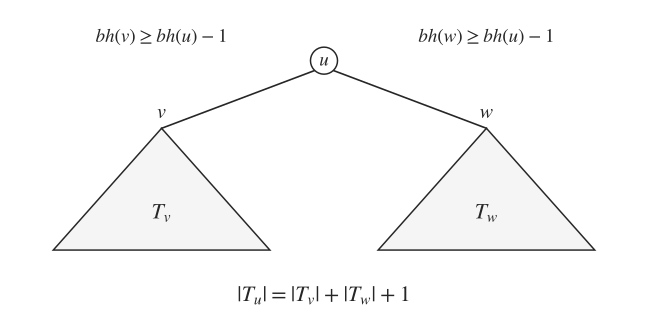
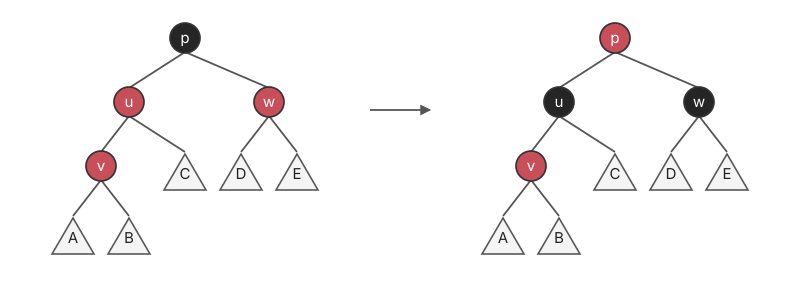
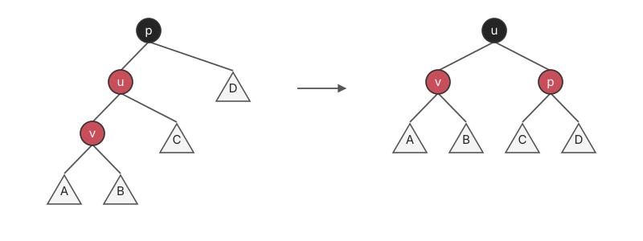
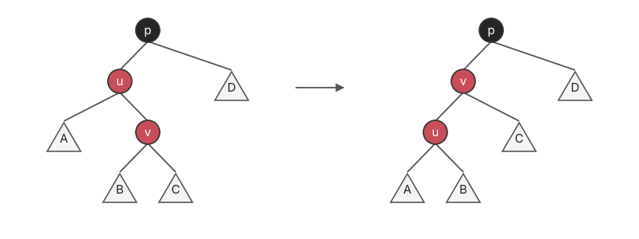
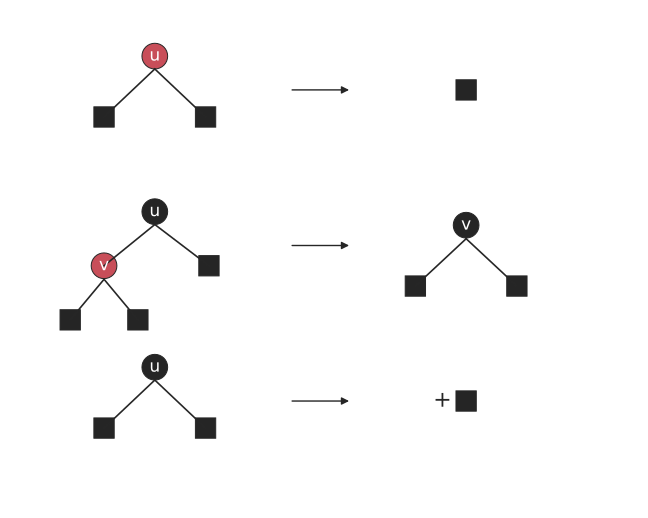
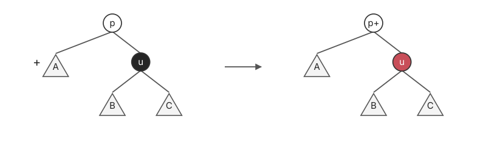
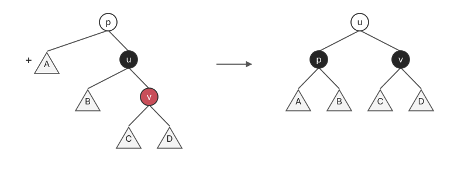
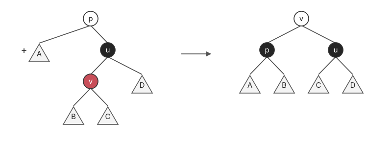
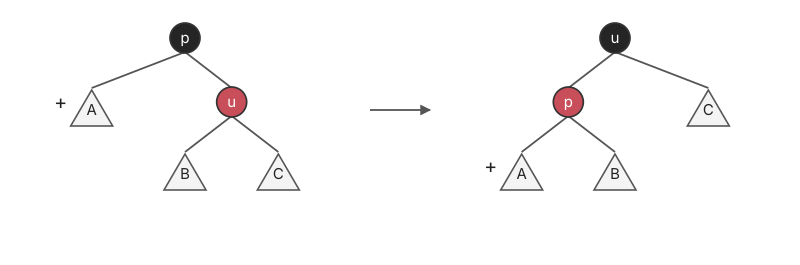

# 红黑树 · Red-black Tree

## 1. 性质

在 BST 的空孩子位置补上 external leaf（NIL）。存储 key 的节点称为 internal node；NIL 不存 key，也不计入节点数 $n$。

BST 加上颜色约束：

1. 内部节点（internal nodes）为红或黑。
2. 根（root）为黑。
3. 外部叶子（external leaf，NIL）为黑。
4. 红节点的 children 一定为黑。
5. 从任意节点 $u$ 到 external leaf 的下降路径，黑节点数相同，不含 $u$。

$bh(u)$ 为 **黑高 · Black Height**：从 $u$ 到 NIL 的下降路径上的黑节点数，不含 $u$、包含终点 NIL；由性质 5，任取一条路径结果相同。$h(u)$ 为到 NIL 的最长路径边数；NIL 自身的 $h=bh=0$。

性质 4 禁止两个红节点连续，因此最长路径中红节点不会多于黑节点：

$$
bh(u)\le h(u)\le 2bh(u).
$$

兄弟子树的黑高至多相差 $1$，且各自的高度在对应黑路径长度的 $1$ 到 $2$ 倍之间。结合性质 4、5，若兄弟子树的高度均非零，则：

$$
\frac12\le\frac{h(v)}{h(w)}\le 2.
$$

## 2. 树高

**Lemma**：含 $n$ 个 internal nodes 的 RBT，有：

$$
\operatorname{height}\le 2\log_2(n+1).
$$

先归纳证明：

$$
\operatorname{size}(T_u)\ge 2^{bh(u)}-1.
$$

**Base case**：$u$ 为 external leaf，$h(u)=bh(u)=0$，$\operatorname{size}(T_u)=0$，成立。

**Inductive hypothesis**：假设高度不超过 $k$ 的子树成立。

**Inductive step**：设 $h(u)=k+1$，左右孩子为 $v,w$，有 $bh(v),bh(w)\ge bh(u)-1$：



$$
\begin{aligned}
\operatorname{size}(T_u)
&=\operatorname{size}(T_v)+\operatorname{size}(T_w)+1\\
&\ge 2^{bh(v)}+2^{bh(w)}-1\\
&\ge 2^{bh(u)-1}+2^{bh(u)-1}-1\\
&=2^{bh(u)}-1.
\end{aligned}
$$

因此：

$$
\operatorname{height}\le 2bh(\mathrm{root})\le 2\log_2(n+1).
$$

## 3. 插入 · Insertion

Insert as BST，mark as red。新节点的两个孩子均为黑色 NIL；染红不会改变各条路径的黑节点数，只可能出现父子均红。若父节点为黑，done；若新节点成为 root，将其改黑。

否则设新节点为 $v$、父节点为 $u$、祖父为 $p$；以下画 $u$ 为左孩子的情形，另一侧对称。

### 3.1 Case 1：叔节点红

父、叔改黑，祖父 $p$ 改红。



- $p$ 的 parent 为黑：done。
- $p$ 是 root：改黑，done。
- $p$ 的 parent 为红：令 $v=p$，继续向上处理。

### 3.2 Case 2：叔节点黑

**Case 2.1**：$v$ 为 $u$ 的左孩子。右旋 $p$，$u$ 改黑、$p$ 改红，done。



**Case 2.2**：$v$ 为 $u$ 的右孩子。先左旋 $u$，转为 Case 2.1。



插入调整的流向为：

```text
Case 1（叔红，0 次旋转）
    ├─ 祖父的父节点为黑 / 祖父为 root → done
    └─ 祖父的父节点为红 → 将祖父视作新的 v，向上继续
Case 2.1（外侧）→ 1 次旋转 → done
Case 2.2（内侧）→ 1 次旋转 → Case 2.1 → done
```

Case 1 最多向上处理 $O(\log N)$ 次，旋转至多 $2$ 次：

$$
O(\log N)\text{ time}+O(1)\text{ rotations}.
$$

## 4. 删除 · Deletion

Del as in BST，实际被删除节点至多有一个 internal child。

- 被删节点为红：直接删。
- 被删节点为黑、有红孩子：孩子替上并改黑。
- 被删节点为黑、孩子均为黑色 NIL：产生 double black，记为 $+$。

这里讨论的是 **BST 交换后真正移除的节点** 的颜色。若原位置有两个 internal children，先与前驱或后继交换 key，再移除至多有一个 internal child 的节点。

- 红色的被删节点不可能再有一个非空黑孩子，否则两侧黑高不等；所以直接删红叶不会改变黑高。
- 黑节点若有唯一非空孩子，该孩子一定为红；替上并染黑，补回被删除的一层黑色。
- 黑叶被删后，其位置的一条黑色路径少了 $1$；用 $+$ 暂记缺少的一层黑色，即 double black。它是调整标记，不是最终树中的第三种颜色。



以下画 double black 在左侧的情形，其 sibling 为 $u$、parent 为 $p$；右侧情形完全对称。旋转图中未指定颜色的 $p$ 表示保留其原色。

### 4.1 Case 1：兄弟节点为黑

**Case 1.1**：$u$ 的两个孩子均黑。$u$ 改红，将额外黑色移到 $p$。



- $p$ 原为红：改黑，done。
- $p$ 为 root：去掉额外黑色，done。
- $p$ 为黑且不是 root：继续向上处理。

此步不旋转；$u$ 少一层黑色后，左右子树重新相等，未解决的额外黑色只可能移到父节点。

**Case 1.2**：$u$ 的右孩子（远侧）为红。左旋 $p$，$u$ 取 $p$ 原色，$p$ 和远侧孩子改黑，done。



**Case 1.3**：$u$ 的左孩子（近侧）红、右孩子黑。先右旋 $u$、交换相关颜色，转为 Case 1.2，再左旋 $p$，done。



### 4.2 Case 2：兄弟节点为红

此时 $p$ 与 $u$ 的两个孩子均为黑。左旋 $p$，$u$ 改黑、$p$ 改红；double black 的新兄弟为原 $u$ 的左孩子，因而转为 Case 1。



删除调整的流向与旋转次数：

| 情形 | 后续处理 | 旋转次数 |
| :--- | :--- | :--- |
| Case 1.1，$p$ 红 | $p$ 改黑，吸收 $+$，done | $0$ |
| Case 1.1，$p$ 为 root | 去掉 $+$，done | $0$ |
| Case 1.1，$p$ 黑且非 root | 将 $+$ 上移，重新分类 | $0$ |
| Case 1.2，远侄红 | 恢复黑高，done | $1$ |
| Case 1.3，近侄红、远侄黑 | 转 Case 1.2，done | $2$ |
| Case 2，兄弟红 | 转 Case 1，新的 $p$ 为红 | 先 $1$ 次 |

Case 2 后若到 Case 1.1，红色 $p$ 会立即吸收 $+$；若到 Case 1.2 / 1.3，再做 $1$ / $2$ 次旋转即结束。因此它不会造成反复旋转。

Case 1.1 可能继续向上，但不旋转；总旋转次数 $c\le 3$：

$$
O(\log N)\text{ time}+O(1)\text{ rotations}.
$$

## 5. AVL 与红黑树的比较

| | AVL | RBT |
| :--- | :--- | :--- |
| Height | 约 $\log_{1.618}n$ | $\le 2\log_2(n+1)$ |
| Insertion | $O(\log n)+O(1)$ rotations | $O(\log n)+O(1)$ rotations |
| Deletion | $O(\log n)+O(\log n)$ rotations | $O(\log n)+O(1)$ rotations |
| 额外记录 | 节点高度 | 节点颜色 |

红黑树放宽了 AVL 的局部平衡要求，仍保持对数树高；其中的区别是删除的 rotation 次数由 $O(\log n)$ 降为 $O(1)$。两者实现均需维护旋转与附加信息。
