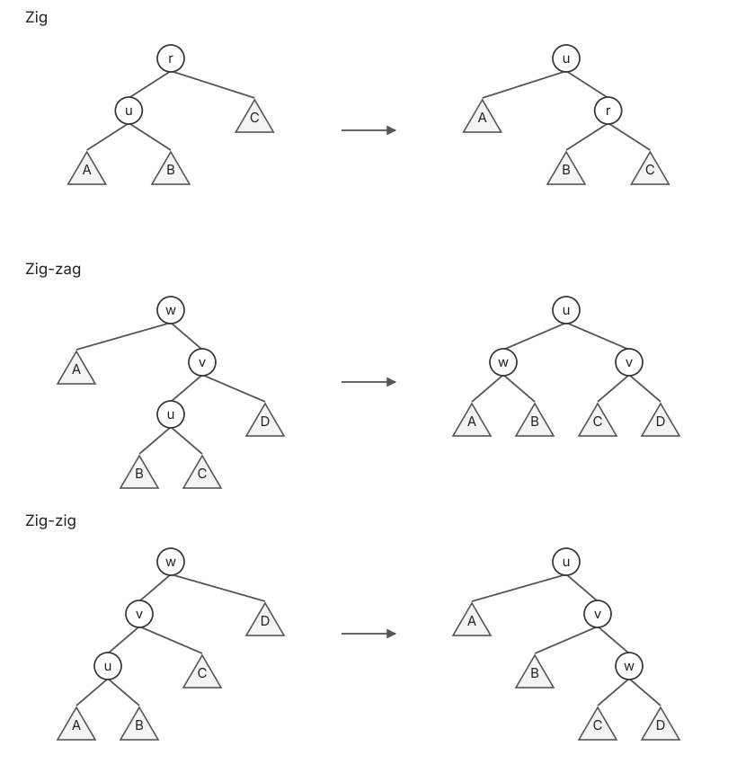
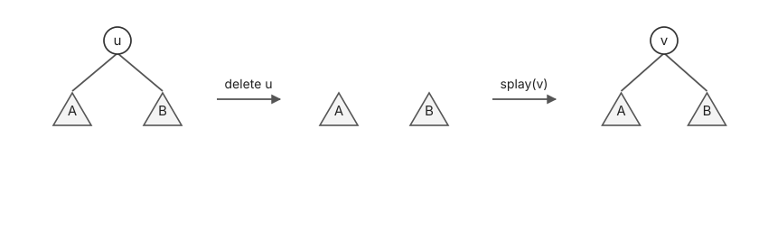

# Splay 树 · Splay Tree

## 1. 伸展操作 · Splay(u)

反复旋转，直到 $u$ 成为 root。

| 情形 | 操作 |
| :--- | :--- |
| Zig：$u$ 是 root 的 child | Rotate $u$ 一次 |
| Zig-zag：$u$ 与父节点 $v$ 方向不同 | Rotate $u$ 两次 |
| Zig-zig：$u$ 与父节点 $v$ 同方向 | 先 rotate $v$，再 rotate $u$ |



## 2. 查找、插入与删除

**Find**：find as in BST，再 splay(u)。

**Insert**：insert as in BST，再 splay(u)。

**Delete**：先 splay(u)，再删除根；若有左右子树 $A,B$，将 $A$ 中最大节点 $v$ 伸展到根，再把 $B$ 接到 $v$ 的右侧。

> **关键**
>
> $v$ 是 $u$ 的 predecessor，也是 $A$ 中最大节点，因此 splay(v) 后没有右孩子。



**伪代码实现如下**

```text
find(u):
1. find as in BST
2. splay(u)

insert(u):
1. insert as in BST
2. splay(u)

delete(u):
1. splay(u)
2. if u has at most one child
3.     delete u and keep its remaining subtree
4. else
5.     delete u, obtaining subtrees A and B
6.     v = predecessor of u
7.     splay(v) in A
8.     attach B to v as its right subtree
```

## 3. 摊还分析

$T_u$ 为以 $u$ 为根的子树，$|T_u|$ 为其节点数。令：

$$
r(u)=\log_2|T_u|,\qquad \Phi(T)=c\sum_{u\in T}r(u).
$$

$T\xrightarrow{\operatorname{splay}(u)}T'$，用 $r'$ 表示旋转后的 rank。

### 3.1 引理证明

引理：令 $q$ 为双旋步骤（Zig-zag / Zig-zig）的次数，$R$ 为单次 rotation 的总数；最后至多再有一次 Zig，故 $R=2q$ 或 $2q+1$：

$$
\boxed{\Phi(T')-\Phi(T)\le 3c\bigl(r'(u)-r(u)\bigr)-2cq.}
$$

每个双旋步骤消去的 $2c$ 用来支付两次 rotation；最后一次 Zig 只需额外付常数代价。

**Zig**：只有 $u,p$ 的 rank 改变，且 $r'(u)=r(p)$：

$$
\frac{\Delta\Phi}{c}
=r'(u)-r(u)+r'(p)-r(p)
\le r'(u)-r(u).
$$

**Zig-zag**：设父、祖父分别为 $v,w$，有 $r'(u)=r(w)$：

$$
\frac{\Delta\Phi}{c}
=r'(u)+r'(v)+r'(w)-r(u)-r(v)-r(w)
\le r'(v)+r'(w)-2r(u).
$$

旋转后 $|T'_u|=|T'_v|+|T'_w|+1$，因此：

$$
|T'_u|^2\ge\bigl(|T'_v|+|T'_w|\bigr)^2\ge4|T'_v||T'_w|.
$$

两边取 $\log_2$：

$$
2r'(u)\ge r'(v)+r'(w)+2
\quad\Rightarrow\quad
\frac{\Delta\Phi}{c}\le 2(r'(u)-r(u))-2.
$$

**Zig-zig**：$T_u$ 与 $T'_w$ 不相交，且均包含在 $T'_u$ 中：

$$
2r'(u)\ge r(u)+r'(w)+2.
$$

又有 $r'(u)\ge r'(v)$、$r(v)\ge r(u)$，所以：

$$
\begin{aligned}
\frac{\Delta\Phi}{c}
&=r'(v)+r'(w)-r(u)-r(v)\\
&\le 2r'(u)-2r(u)-2+r'(v)-r(v)\\
&\le 3(r'(u)-r(u))-2.
\end{aligned}
$$

每个双旋步骤提供 $-2c$；最后至多一次 Zig。若双旋步骤数为 $k$，总 rotation 数为 $R$，则 $R\le 2k+1$：

$$
\Delta\Phi\le 3c(r'(u)-r(u))-2ck
\quad\Rightarrow\quad
cR+\Delta\Phi\le 3c(r'(u)-r(u))+c.
$$

### 3.2 操作复杂度

**Find**：实际代价与查找路径长度、rotation 数成正比，取足够大的常数 $c$：

$$
\widehat T\le 3c\log n+c=O(\log n).
$$

将 find 的实际成本记为 $cR$；由引理抵消旋转代价后，只剩 $O(\log n)$ 的 rank 差。取常数后可写成 $3c\log n+2c\le 5c\log n$（$n\ge2$）。

**Insert**：插入使查找路径上的 rank 增加，再加 splay 的势能变化；扩大势函数的常数系数即可抵消路径代价，摊还 $O(\log n)$。

具体将势能拆成“BST 插入”与“splay”两部分。新叶子的 rank 为 $0$；设插入前沿祖先路径的子树大小为 $s_1<\cdots<s_d\le n$：

$$
\Delta\Phi_{\mathrm{BST}}
=c\sum_{j=1}^{d}\log_2\frac{s_j+1}{s_j}
\le c\sum_{s=1}^{n}\log_2\frac{s+1}{s}
=c\log_2(n+1).
$$

再由引理支付路径查找与 splay 的成本，取足够大的常数 $c$：

$$
\begin{aligned}
\Delta\Phi_{\mathrm{ins}}
&=\Delta\Phi_{\mathrm{BST}}+\Delta\Phi_{\mathrm{splay}}\\
&\le4c\log_2(n+1)-2cq,\\
\widehat T_{\mathrm{ins}}&\le4c\log_2(n+1)+c\le5c\log_2(n+1).
\end{aligned}
$$

总摊还代价仍为 $O(\log n)$。查找深度等于新叶子伸展到根所需的 rotation 数。

**Delete**：分成 splay(u)、删除根、在 $A$ 中 splay(v)、attach $B$ 四步：

$$
\Delta\Phi=\Delta\Phi_1+\Delta\Phi_2+\Delta\Phi_3+\Delta\Phi_4,
\qquad
\Delta\Phi_2=-c\log n,
$$

$$
\Delta\Phi_4=c\log(|A|+|B|)-c\log|A|\le c\log n.
$$

四项势能变化分别为：

$$
\begin{aligned}
\Delta\Phi_1&\le3c\bigl(r'_1(u)-r_1(u)\bigr)-2cq_1,\\
\Delta\Phi_2&=-c\log n,\\
\Delta\Phi_3&\le3c\bigl(r'_3(v)-r_3(v)\bigr)-2cq_3,\\
\Delta\Phi_4&=c\log(|A|+|B|)-c\log|A|.
\end{aligned}
$$

删除根与最后 attach 的两项合起来不增加势能；两次 splay 的负项支付对应 rotations。因此 delete 的摊还代价可取 $6c\log n+2c\le8c\log n$（$n\ge2$）。

两次 splay 均由引理控制，因此 find / insert / delete 的摊还复杂度均为 $O(\log n)$。
