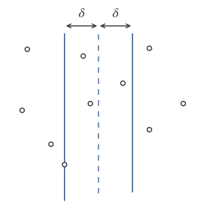
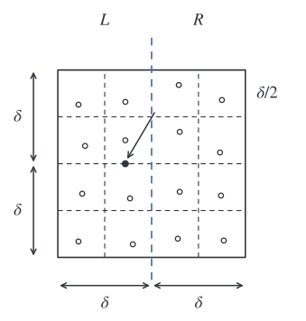
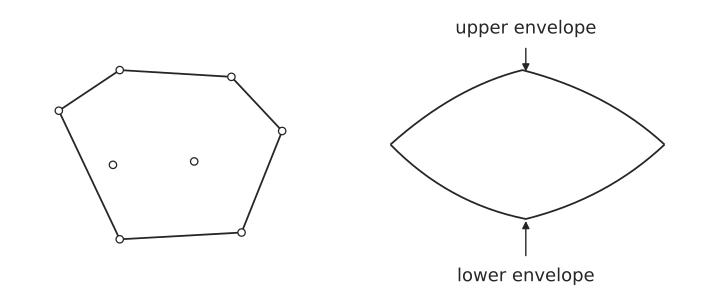
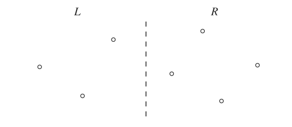
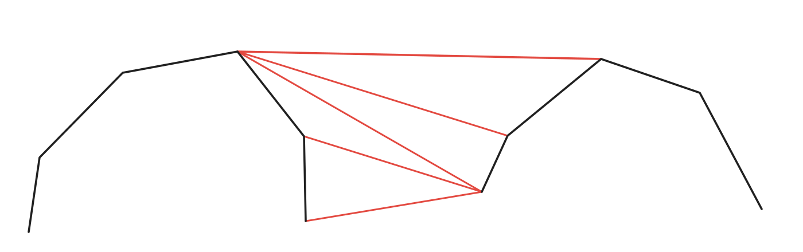

# 分治 · Divide and Conquer

> **Divide → Conquer → Merge**
>
> 划分子问题 → 递归求解 → 合并结果。

## 1. 整数乘法

设两个 $n$ 位十进制整数为：

$$
A=\overline{a_1a_2\cdots a_n},
\qquad
B=\overline{b_1b_2\cdots b_n}.
$$

其中 $a_i,b_i\in\{0,1,\ldots,9\}$，横线表示这些数字拼成的整数。

普通乘法需要：

$$
T(n)=\Theta(n^2).
$$

### 1.1 分成高位与低位

为方便分析，假设 $n$ 为 $2$ 的幂，不足时在高位补零。

前 $n/2$ 位为高位部分，后 $n/2$ 位为低位部分。令：

$$
\begin{aligned}
A_H&=\overline{a_1a_2\cdots a_{n/2}},\\
A_L&=\overline{a_{n/2+1}a_{n/2+2}\cdots a_n},\\
B_H&=\overline{b_1b_2\cdots b_{n/2}},\\
B_L&=\overline{b_{n/2+1}b_{n/2+2}\cdots b_n}.
\end{aligned}
$$

因此：

$$
A=A_H\cdot 10^{n/2}+A_L,
\qquad
B=B_H\cdot 10^{n/2}+B_L.
$$

展开：

$$
\begin{aligned}
AB
&=(A_H10^{n/2}+A_L)(B_H10^{n/2}+B_L)\\
&=A_HB_H\cdot 10^n
 +(A_HB_L+A_LB_H)\cdot 10^{n/2}
 +A_LB_L.
\end{aligned}
$$

直接递归计算，需要 **4 次半规模乘法**：

$$
T(n)=4T(n/2)+O(n).
$$

$$
T(n)=n\cdot\frac{2^{\log_2 n}-1}{2-1}=O(n^2).
$$

### 1.2 减少一次乘法

关键：

$$
A_HB_L+A_LB_H
=
(A_H+A_L)(B_H+B_L)-A_HB_H-A_LB_L.
$$

> **关键**
>
> 用加减法换掉一次递归乘法：$4$ 次变为 $3$ 次。

有：

$$
T(n)=3T(n/2)+O(n).
$$

$$
T(n)=n\cdot\frac{\left(\frac32\right)^{\log_2 n}-1}{\frac32-1}=O\left(n^{\log_2 3}\right).
$$

---

## 2. 逆序对 · Counting Inversions

### 2.1 定义

对于数组 $A$，若：

$$
i<j
\quad\text{且}\quad
A[i]>A[j],
$$

则 $(i,j)$ 是一个逆序对。

暴力检查所有下标对：

$$
\binom n2=\Theta(n^2).
$$

### 2.2 分治处理

将数组按位置分成左右两半：

```text
A = [       L       |       R       ]
        left half       right half
```

逆序对分为三类：

| 类型 | 两个元素的位置 |
| :--- | :--- |
| Left inversions | 都在 $L$ |
| Right inversions | 都在 $R$ |
| Split inversions | 前一个在 $L$，后一个在 $R$ |

因此：

$$
\operatorname{Inv}(A)
=
\operatorname{Inv}(L)
+
\operatorname{Inv}(R)
+
\operatorname{SplitInv}(L,R).
$$

强行枚举 split inversions，需要检查 $\frac n2\times\frac n2=\frac{n^2}{4}$ 对元素。复杂度为 $O(n^2)$。

### 2.3 分治加额外排序预处理

递归统计 left inversions、right inversions，同时得到排好序的左右序列。

左右均已排序，合并时用双指针统计 split inversions：

- 若左序列第 $i$ 个元素 $\le$ 右序列第 $j$ 个元素：将左侧元素放入 $D$，$\mathrm{splitInv}$ 不变。
- 否则：将右侧元素放入 $D$，$\mathrm{splitInv}=\mathrm{splitInv}+\text{左序列剩余元素个数}$。

一侧取完后，将另一侧剩余元素依次放入 $D$，返回 $(D,\mathrm{splitInv})$。

左右各扫描一次，统计 split inversions 的代价为：

$$
\frac n2\times 2=n\quad\Rightarrow\quad O(n).
$$

有：

$$
\begin{cases}
T(1)=O(1),\\
T(n)=2T(n/2)+O(n)
\end{cases}
\quad\Rightarrow\quad O(n\log n).
$$

**伪代码实现如下**

**Sort-and-CountInv**

```text
Sort-and-CountInv(A):
1. if n <= 2
2.     trivial
3. else
4.     L = left half of A
5.     R = right half of A
6.     (B, LeftInv) = Sort-and-CountInv(L)
7.     (C, RightInv) = Sort-and-CountInv(R)
8.     (D, SplitInv) = Merge-and-CountSplit(B, C)
9.     return (D, LeftInv + RightInv + SplitInv)
```

**Merge-and-CountSplit**

```text
Merge-and-CountSplit(B, C):
1.  i = 1, j = 1, SplitInv = 0
2.  for k = 1 to n:
3.      if B[i] < C[j]
4.          D[k] = B[i]
5.          i = i + 1
6.          SplitInv = SplitInv + n/2 - i + 1
7.      else
8.          D[k] = C[j]
9.          j = j + 1
10.         SplitInv = SplitInv + n/2 - i + 1
11. return (D, SplitInv)
```

---

## 3. 最近点对 · Closest Pair

### 3.1 一维情况

按坐标排序后，只需检查相邻点之间的距离：

$$
\delta=\min_{1\le i<n}|x_{i+1}-x_i|,\qquad O(n\log n).
$$

### 3.2 二维分治思想

将点集按 $x$ 坐标分成左右两半：

| 类型 | 两个点的位置 |
| :--- | :--- |
| Closest left pair | 都在左半部分，最近距离为 $\delta_L$ |
| Closest right pair | 都在右半部分，最近距离为 $\delta_R$ |
| Split pair | 左右各一个点 |

令：

$$
\delta=\min\{\delta_L,\delta_R\}.
$$

设 $\bar x$ 为左半部分最大的 $x$ 坐标。要找到距离小于 $\delta$ 的 split pair，只需考虑中间宽度为 $2\delta$ 的条带：

$$
\bar x-\delta\le x\le\bar x+\delta.
$$



条带内的点按 $y$ 坐标排序，记为 $S_y$。对每个点，只需考虑其上方纵向距离不超过 $\delta$ 的点。



将这个 $2\delta\times\delta$ 的区域分成 $8$ 个边长为 $\delta/2$ 的小方格。每格最多一个点，否则同侧两点距离：

$$
\sqrt{\left(\frac\delta2\right)^2+\left(\frac\delta2\right)^2}
=\frac\delta{\sqrt2}<\delta,
$$

与左右两侧各自的最近距离均不小于 $\delta$ 矛盾。

> **关键**
>
> 按 $y$ 排序后，每个点只需与后面的 $8$ 个点比较，每个点只花费常数时间。

因此，检查条带的代价为 $O(8|S_y|)=O(n)$。

### 3.3 具体实现

输入 $n$ 个点组成的点集 $P$，假设任意不同两点满足 $p_x\ne q_x$、$p_y\ne q_y$。

预先排序，得到：

- $P_x$：按 $x$ 坐标排序。
- $P_y$：按 $y$ 坐标排序。

排序代价为 $O(n\log n)$。每次按左右归属，将 $P_x$、$P_y$ 线性划分为 $L_x,L_y,R_x,R_y$，保留原有顺序，无需重新排序。

递归求出左右最近点对，再检查条带内的 split pair，返回三者中距离最小的点对。

有：

$$
\begin{cases}
T(n)=O(1), & n\le 3,\\
T(n)=2T(n/2)+O(n), & n>3
\end{cases}
\quad\Rightarrow\quad O(n\log n).
$$

**伪代码实现如下**

**ClosestPair**

```text
ClosestPair(Px, Py):
1.  if n <= 3
2.      trivial
3.  L = points on the left half plane
4.  R = points on the right half plane
5.  form arrays Lx, Ly, Rx, Ry from Px, Py in O(n) time
6.  (l1, l2) = ClosestPair(Lx, Ly)
7.  (r1, r2) = ClosestPair(Rx, Ry)
8.  delta = min(d(l1, l2), d(r1, r2))
9.  (s1, s2) = ClosestSplitPair(Px, Py, delta)
10. return closest among (l1, l2), (r1, r2), (s1, s2)
```

**ClosestSplitPair**

```text
ClosestSplitPair(Px, Py, delta):
1.  x_bar = the largest x-coordinate of points on the left half plane
2.  Sy = (q1, ..., qk) with x_bar - delta <= qi.x <= x_bar + delta,
         in Py order
3.  MinDist = INF
4.  ClosestPair = NULL
5.  for i = 1 to k:
6.      for j = 1 to min(8, k - i):
7.          if d(qi, q(i+j)) < MinDist
8.              MinDist = d(qi, q(i+j))
9.              ClosestPair = (qi, q(i+j))
10. return ClosestPair
```

---

## 4. 凸包 · Convex Hull

### 4.1 凸包与上下包络

包含点集 $P$ 的最小凸集记作 $\operatorname{CH}(P)$。平面中，其边界为凸多边形，内部点不出现在边界上。

从最左点到最右点，边界分成 **upper envelope（上包络）** 与 **lower envelope（下包络）**：



### 4.2 分治思想

先按 $(x,y)$ 排序、去重，再从中间分为 $L,R$。分别递归得到左右点集的**上凸壳、下凸壳**：

$$
(U_L,D_L)=\operatorname{Hull}(L),\qquad
(U_R,D_R)=\operatorname{Hull}(R).
$$



先合并两个上凸壳 $U_L,U_R$：从左侧上凸壳的最右端与右侧上凸壳的最左端开始连接，检查接缝处是否仍保持上凸。



图中黑线是两个上凸壳，红线是逐步调整的候选连接：

- 连接右侧当前点时，若左侧末端折向内部，就回退左侧端点至符合。
- 继续扫描右侧上凸壳；若新点在候选连接上方，就弹出接缝处不再需要的点，更新连接至符合，回到第一步检查，不符合继续循环，符合来到第三步。
- 最终得到图中最上方的公共上切线，保留左侧外段、连接线和右侧外段，形成合并后的上凸壳。

**两个下凸壳 $D_L,D_R$ 的合并同理**，只需反转转向判断。最后再由上、下凸壳拼成整个凸包。

> **关键**
>
> 分别合并上凸壳、下凸壳；各子问题的内部点无需重新参与合并。

### 4.3 合并与具体实现

用两条从左到右排列的链保存子问题的结果：上凸壳 $U$、下凸壳 $D$。上凸壳之间做一次 merge，下凸壳之间再做一次 merge；每次只删除接缝附近不满足对应凸性的点。

定义叉积：

$$
\operatorname{cross}(a,b,c)
=(b_x-a_x)(c_y-a_y)-(b_y-a_y)(c_x-a_x).
$$

- $>0$：$a\to b\to c$ 左转，$c$ 在有向直线 $a\to b$ 左侧。
- $<0$：右转。
- $=0$：共线。

从左向右扫描，**上链只保留右转，下链只保留左转**。若新点使最后三个点不满足要求，弹出中间点，继续向前检查；上凸壳的弹栈过程即上图中红色候选连线的变化；下凸壳将判断方向反过来。

**伪代码实现如下**

```text
MergeChain(A, B, upper):
1.  S = empty stack
2.  for p in A followed by B:       // 两条链均按 (x, y) 排序
3.      while |S| >= 2:
4.          turn = cross(S[-2], S[-1], p)
5.          if (upper and turn >= 0) or (not upper and turn <= 0)
6.              S.pop()
7.          else
8.              break
9.      S.push(p)
10. return S

Hull(P):                           // P 已排序、去重
1.  if |P| <= 1
2.      return (P, P)
3.  L, R = left half and right half of P
4.  (UL, DL) = Hull(L)
5.  (UR, DR) = Hull(R)
6.  U = MergeChain(UL, UR, upper = true)
7.  D = MergeChain(DL, DR, upper = false)
8.  return (U, D)
```

最后将下链从左到右、上链从右到左拼接，两个公共端点各保留一次，得到逆时针凸包；只有一个点时直接返回该点。共线中间点在弹栈时删除，故全部点共线时只保留两个端点。

每个点在一次合并中至多入栈、出栈各一次，两条链合计 $O(n)$：

$$
\begin{cases}
T(1)=O(1),\\
T(n)=2T(n/2)+O(n)
\end{cases}
\quad\Rightarrow\quad O(n\log n).
$$

预排序同为 $O(n\log n)$，总复杂度仍为 $O(n\log n)$。

### 4.4 后续优化：输出敏感复杂度

**Timothy Chan，1996提出算法复杂度为**：

$$
O(n\log h),\qquad h=\#\{\text{凸包顶点}\}.
$$

**输出敏感**：复杂度同时取决于输入点数 $n$ 和输出顶点数 $h$。内部点再多，也不需要逐个输出；当 $h\ll n$ 时，$\log h$ 可以比 $\log n$ 小很多。最坏 $h=n$，仍为 $O(n\log n)$。

Chan 的思路是 **先分组求小凸包，再沿外边界逐点“包裹”**。先假设已知 $h$：

1. 将 $n$ 个点任意分为 $\lceil n/h\rceil$ 组，每组至多 $h$ 个点；分别求小凸包，总计 $O(n\log h)$。
2. 从最左点出发，依次寻找全局凸包的下一个顶点。对每个小凸包，用二分寻找从当前点出发的切点，耗时 $O(\log h)$；再从这些候选切点中选出最外侧的一个。
3. 每次确定一个全局凸包顶点，共走 $h$ 步，回到起点结束：

$$
O\!\left(h\cdot\left\lceil\frac nh\right\rceil\log h\right)=O(n\log h).
$$

**为什么更快**：每一步只在各小凸包上二分找候选点，不再扫描全部 $n$ 个原始点；总共只确定最终输出的 $h$ 个顶点。

实际并不知道 $h$，就猜组大小 $m=2,4,16,256,\ldots$（每轮平方，最多到 $n$）。每轮最多包裹 $m$ 步，未闭合则扩大 $m$ 重试；各轮的 $\log m$ 成倍增长，总代价由最后一轮控制，仍为 $O(n\log h)$。

上面的基础分治实现逐层合并上、下凸壳，复杂度为 $O(n\log n)$；这里补充的是 Chan 算法利用输出规模 $h$ 的进一步改进。


参考：[分治凸包合并](https://www.cs.cmu.edu/afs/cs/academic/class/15451-f14/www/lectures/lec22/geometry-with-figures.pdf) · [Chan（1996）](https://doi.org/10.1007/BF02712873) · [Chan 算法思路](https://jeffe.cs.illinois.edu/teaching/373/notes/x05-convexhull.pdf)。
