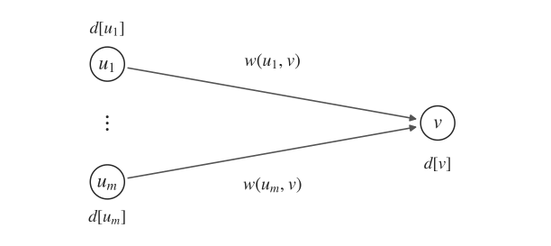
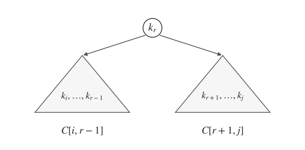
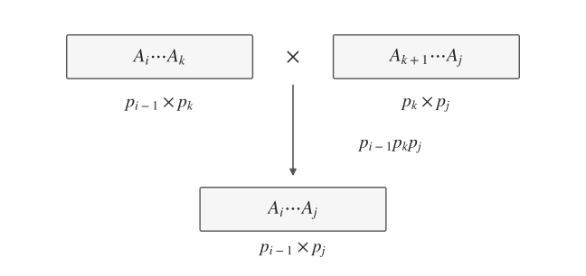
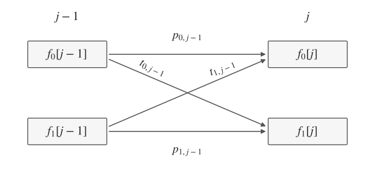
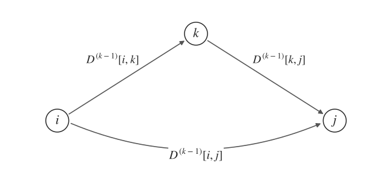

# 动态规划 · Dynamic Programming

## 1. 有向无环图最短路 · Shortest Path in DAGs

$d[v]$：从起点 $s$ 到 $v$ 的最短距离。

到达 $v$ 的路径，最后一定经过某条入边 $(u,v)$。这之前从 $s$ 到 $u$ 的部分应取最短路，否则可以替换成更短的前缀。

因此，枚举 $v$ 的所有前驱：

$$
\boxed{d[v]=\min_{(u,v)\in E}\{d[u]+w(u,v)\}}\qquad(v\ne s).
$$

$d[u]$ 为已经确定的前缀代价，$w(u,v)$ 为最后一条边的代价。

**边界与顺序**：$d[s]=0$，其余初值为 $+\infty$。按**拓扑序**计算，所有前驱均排在当前节点前面，因此转移时依赖已经算好；无前驱可达时仍为 $+\infty$。

每条边只参与一次转移，总复杂度 $O(|V|+|E|)$。允许负边权，关键是图中无环。

## 2. 最大连续子段和 · Maximum Subsequence Sum

这里指**连续、非空**子段。

$F[i]$：以 $a_i$ **结尾**的最大子段和。强调结尾位置，才能判断下一项是否能直接接上。

以 $i$ 结尾的子段只有两种来源：

- 从 $i$ 重新开始，只取 $a_i$。
- 将 $a_i$ 接在以 $i-1$ 结尾的最优子段后面。

$$
\boxed{F[i]=\max\{a_i,\ F[i-1]+a_i\}}.
$$

前一段为负时，接上它只会变差，因此舍弃；否则保留前一段。

$$
F[1]=a_1,\qquad \mathrm{Ans}=\max_{1\le i\le n}F[i].
$$

最优子段不一定在 $n$ 处结束，所以答案在全部 $F[i]$ 中取最大值。由于要求非空，不能将答案初值直接设为 $0$。

从左到右计算，只依赖上一项：$O(n)$ time，$O(1)$ 额外 space。

## 3. 最优二叉搜索树 · Optimal Binary Search Tree

$k_1<\cdots<k_n$，成功查询 $k_i$ 的概率为 $p_i$。目标为最小化 $\sum_i p_i\cdot\text{比较次数}(k_i)$，这里只计成功查询。

$C[i,j]$：将 $k_i,\ldots,k_j$ 建成 BST 的最小加权比较次数，子树的根按第 $1$ 次比较计。

枚举根 $k_r$。由 BST 的有序性，左、右子树的 key 集合恰好是连续区间 $[i,r-1]$、$[r+1,j]$：

$$
\boxed{
C[i,j]=\min_{i\le r\le j}\{C[i,r-1]+C[r+1,j]\}
+\sum_{k=i}^{j}p_k
}.
$$

- $C[i,r-1]+C[r+1,j]$：左右子树各自的最优代价。
- $\sum_{k=i}^{j}p_k$：每次查询都要先与新根比较一次。子树内节点的比较次数增加 $1$，根自身也贡献 $p_r$。

**边界与答案**：

$$
C[i,i-1]=0,\qquad C[i,i]=p_i,\qquad \mathrm{Ans}=C[1,n].
$$

空区间代价为 $0$，因此根取区间端点时也能直接使用同一方程。

按区间长度递增；前缀和求区间概率和，$O(n^3)$ time、$O(n^2)$ space。若需还原树，记录每个区间取得最小值时的根 $r$。

## 4. 0–1 背包 · 0–1 Knapsack

物品 $i$ 的重量、价值为 $w_i>0,v_i$，容量为 $W$，每件至多选一次。

$F[i,c]$：前 $i$ 件物品、总重量**不超过** $c$ 的最大价值。$i$ 限定可选物品集合，$c$ 限定可用容量。

对物品 $i$，只需决定选或不选：

$$
\boxed{
F[i,c]=
\begin{cases}
F[i-1,c], & c<w_i,\\
\max\{F[i-1,c],\ F[i-1,c-w_i]+v_i\}, & c\ge w_i.
\end{cases}
}
$$

- **不选 $i$**：容量不变，答案来自 $F[i-1,c]$。
- **选 $i$**：先获得 $v_i$，剩余容量为 $c-w_i$，再从前 $i-1$ 件中补。

两种选择都转移到第 $i-1$ 层，保证第 $i$ 件不会被重复使用。

$$
F[0,c]=0,\qquad \mathrm{Ans}=F[n,W].
$$

初始化为 $0$，因为容量是“不超过”，允许不选物品。

**一维压缩**：每处理一件物品，按 $c=W,W-1,\ldots,w_i$ 更新：

$$
F[c]=\max\{F[c],\ F[c-w_i]+v_i\}.
$$

容量必须**降序**：更新 $F[c]$ 时，较小容量 $F[c-w_i]$ 尚未被当前物品更新，仍属于上一层。

$O(nW)$ time，压缩后 $O(W)$ space。

## 5. 矩阵链乘法 · Matrix Multiplication

矩阵 $A_i$ 的维度为 $p_{i-1}\times p_i$。矩阵顺序不变，只改变括号位置。

$M[i,j]$：计算 $A_i\cdots A_j$ 的最少标量乘法次数。

枚举**最后一次乘法**的分割点 $k$，将整个区间分成 $A_i\cdots A_k$ 与 $A_{k+1}\cdots A_j$：

$$
\boxed{
M[i,j]=\min_{i\le k<j}
\{M[i,k]+M[k+1,j]+p_{i-1}p_kp_j\}
}.
$$

前两项分别完成左右子链。它们的结果维度固定为 $p_{i-1}\times p_k$、$p_k\times p_j$，因此最后一次相乘的代价为 $p_{i-1}p_kp_j$。

左右子链如何加括号，不影响结果维度，所以可分别取最优解。

$$
M[i,i]=0,\qquad \mathrm{Ans}=M[1,n].
$$

单个矩阵无需乘法。按区间长度递增计算，$O(n^3)$ time、$O(n^2)$ space。若需还原括号，记录最优分割点 $k$，再递归还原左右两段。

## 6. 装配线调度 · Product Assembly

两条装配线 $\ell\in\{0,1\}$，stage 为 $0,\ldots,n$：

- $p_{\ell,j}$：从本线 stage $j$ 沿原线到下一 stage 的加工耗时。
- $t_{\ell,j}$：从本线 stage $j$ 换到另一线下一 stage 的总耗时。

$f_\ell[j]$：到达第 $\ell$ 条线 stage $j$ 的最短时间。

只需记当前线与 stage：到达同一状态后，后续可选路线及代价相同，因此只保留到达它的最小费用。

上一 stage 只能来自本线或另一线：

$$
\boxed{
f_\ell[j]=\min\{
 f_\ell[j-1]+p_{\ell,j-1},
 f_{1-\ell}[j-1]+t_{1-\ell,j-1}
\}
}.
$$

- **沿原线**：从 $f_\ell[j-1]$ 出发，加上本线的该步加工耗时。
- **从另一线换入**：从 $f_{1-\ell}[j-1]$ 出发，加上从另一线跨到当前线该 stage 的总耗时。

这里 $p,t$ 均按对应边的完整费用计，分别对应图中的横边和斜边。

$$
f_0[0]=f_1[0]=0,\qquad \mathrm{Ans}=\min\{f_0[n],f_1[n]\}.
$$

stage $0$ 为起点，可任选一条线进入；最后也可从任一条线结束。

按 stage 递增计算，$O(n)$ time；同一 stage 的两个值都由上一 stage 得到，只保留前后两层，$O(1)$ space。

## 7. 再看最短路 · Shortest Path, Revisited

### 7.1 多源最短路 · Floyd–Warshall

先假设图中无负环。

$D^{(k)}[i,j]$：内部中间点只允许从 $\{1,\ldots,k\}$ 中选时，$i\to j$ 的最短距离。$k$ 限定的是可用中间点，**不是路径的边数**。

考虑新加入的点 $k$ 是否出现在最短路中：

$$
\boxed{
D^{(k)}[i,j]=\min\{
D^{(k-1)}[i,j],
D^{(k-1)}[i,k]+D^{(k-1)}[k,j]
\}
}.
$$

- **不经过 $k$**：原来的最优值仍可用。
- **经过 $k$**：在 $k$ 处分成 $i\to k$ 与 $k\to j$；两段的内部中间点都只需从前 $k-1$ 个点中选择。

图中箭头表示对应子问题的最短路，不限于一条边。

$$
D^{(0)}[i,j]=
\begin{cases}
0, & i=j,\\
w(i,j), & i\ne j\text{ 且有边},\\
+\infty, & \text{其余情况}.
\end{cases}
$$

初始时不允许内部中间点，只能留在自身或直接走一条边。最终答案为 $D^{(n)}[i,j]$。

二维原地更新时，循环顺序为 **$k\to i\to j$**，$k$ 必须在最外层，以保证先完成一整层允许中间点的扩展。

$O(n^3)$ time、$O(n^2)$ space。

### 7.2 负权最短路 · Bellman–Ford

允许负边权。有环图中，直接按顶点定义状态会产生相互依赖，因此给**边数**加一维。

$F_k(v)$：从 $v$ 到终点 $t$、至多使用 $k$ 条边的最短距离。

$$
\boxed{
F_k(v)=\min\left\{
F_{k-1}(v),
\min_{(v,u)\in E}\{w(v,u)+F_{k-1}(u)\}
\right\}
}.
$$

- 第一项：沿用至多使用 $k-1$ 条边的答案，本轮不必增加边。
- 第二项：枚举第一条边 $(v,u)$，付出 $w(v,u)$ 后，从 $u$ 到 $t$ 至多再使用 $k-1$ 条边。

所有依赖均在上一层，因而每层可以独立计算。

$$
F_0(v)=
\begin{cases}
0, & v=t,\\
+\infty, & v\ne t.
\end{cases}
$$

不使用边时，只能从 $t$ 到自身；其余起点均不可达。

无负环时，最短路可取简单路径，至多 $n-1$ 条边，因此答案为 $F_{n-1}(v)$；不可达时为 $+\infty$。

每轮只读上一轮，$O(|V||E|)$ time；滚动数组 $O(|V|)$ 额外 space。
