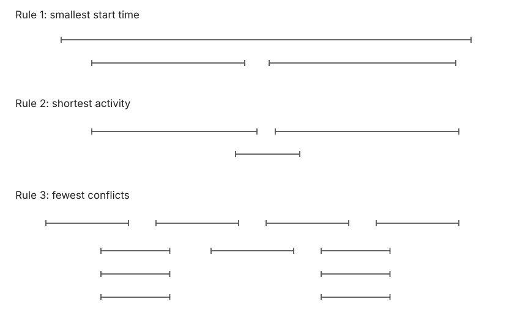
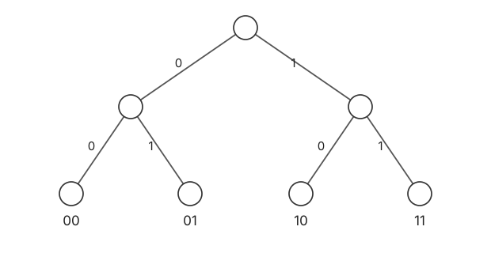
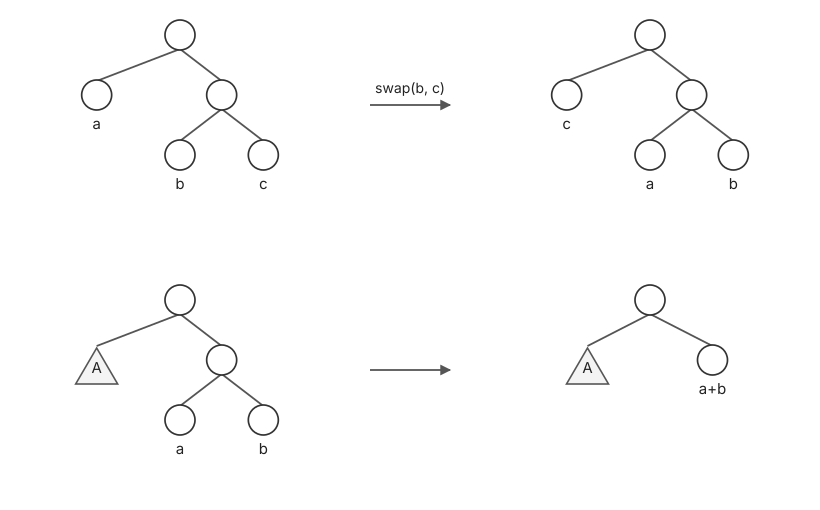
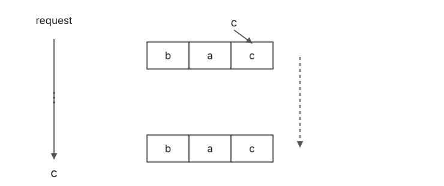
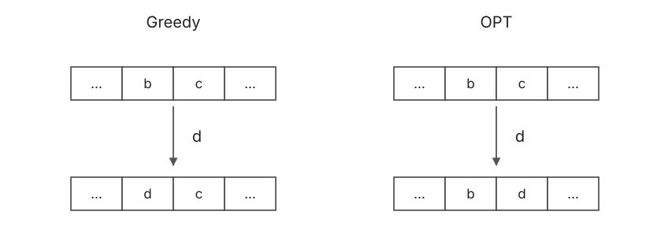

# 贪心 · Greedy

## 1. 活动选择 · Activity Selection

### 1.1 问题与选择规则

Input：$n$ 个活动 $(s_1,f_1),\ldots,(s_n,f_n)$，分别为 start / finish。

Output：数量最多、mutually compatible（相互不冲突）的活动集合。

| Rule | 选择依据 |
| :--- | :--- |
| 1 | Smallest start time |
| 2 | Shortest activity |
| 3 | Fewest conflicts |
| 4 | **Earliest finish time** |

前三种规则均有反例：



### 1.2 算法与交换证明

按 finish time 递增排序，依次选择与已选活动不冲突的活动。

设贪心解 $A=(i_1,\ldots,i_k)$，假设存在更优解 $A^*=(j_1,\ldots,j_k,j_{k+1},\ldots)$。

取第一个不同位置 $t$，由贪心选择：

$$
f(i_t)\le f(j_t).
$$

用 $i_t$ 替换 $j_t$，不会影响后续活动的可行性。重复替换，直到前 $k$ 个活动与 $A$ 相同。

此时 $j_{k+1}$ 仍可接在 $i_k$ 之后，与贪心已经结束矛盾。因此 $A$ 最优。

排序 $O(n\log n)$、扫描 $O(n)$，总复杂度为 $O(n\log n)$。

**伪代码实现如下**

```text
ActivitySelection(R):
1. let R be the set of activities
2. let A = empty set
3. sort R by increasing order of finish time
4. for i in R:
5.     if i does not conflict with A
6.         add i to A
7. return A
```

排序后，判断是否冲突只需比较当前活动的 $s_i$ 与最后一个已选活动的 finish time。

## 2. 哈夫曼编码 · Huffman Coding

### 2.1 无前缀编码 · Prefix-free Code

字母表 $\Sigma$，编码 $r:\Sigma\to\{0,1\}^*$。对任意 $a\ne b$，$r(a)$ 不是 $r(b)$ 的前缀。

例如：$A\mapsto0$，$B\mapsto10$，$C\mapsto110$，$D\mapsto111$。

给定每个字符的频率 $f_a$，最小化：

$$
\sum_{a\in\Sigma}|r(a)|f_a
\quad\Longleftrightarrow\quad
\min_T\sum_{a\in\Sigma}\operatorname{depth}_T(a)f_a.
$$



### 2.2 算法与最优性

每个字符先建一棵单节点树，每次合并频率最小的两棵树，权重相加。

**Lemma**：一定存在一棵最优树，使频率最小的 $a,b$ 互为最深处的 siblings。

将 $a,b$ 交换到最深的一对兄弟叶子位置，代价不会增加。

这个交换分为两种：$a,b$ 已是最深的一对 siblings，则不需操作；若 $a$ 旁边是其他叶子 $c$，将 $b,c$ 交换。若 $f_b\le f_c$、$\operatorname{depth}(b)\le\operatorname{depth}(c)$，交换带来的代价变化为：

$$
(f_b-f_c)\bigl(\operatorname{depth}(c)-\operatorname{depth}(b)\bigr)\le0.
$$

必要时先把 $a$ 放到最深叶子，再把 $b$ 放到其兄弟位置，即得到所需的最优树。



**Base case**：$n=2$，显然最优。

**Inductive hypothesis**：$n=k$ 时算法最优。

**Inductive step**：$n=k+1$ 时，将最小的两个 $a,b$ 合并为 $a+b$，得到 $k$ 个对象的最优树，再展开这两个叶子。

$$
\operatorname{cost}(T)=\operatorname{cost}(T')+f_a+f_b.
$$

新增代价与其余树结构无关，因此展开后仍最优。

若输入频率已有序，用两个 queue 分别维护原始叶子与新合并的树；每次取最小的两个仅需 $O(1)$，总计 $O(n)$。无序时先排序，总计 $O(n\log n)$。

**伪代码实现如下**

```text
Huffman(Sigma):
1.  for a in Sigma:
2.      create a single-node tree T_a
3.      f(T_a) = f_a
4.  let F be the set of all trees
5.  while |F| >= 2:
6.      T1, T2 = the two trees in F with minimum f
7.      F = F - {T1, T2}
8.      T3 = merge(T1, T2)
9.      f(T3) = f(T1) + f(T2)
10.     add T3 to F
11. return F
```

## 3. 离线缓存 · Offline Caching

### 3.1 缓存替换

Cache 容量为 $k$，请求序列为 $d_1,\ldots,d_m$。

请求已在 cache 中则直接读取，否则读入；cache 满时需替换一个元素。目标是最少的 cache misses。

| 策略 | 替换规则 |
| :--- | :--- |
| LRU | 最近一次访问时间最早的元素 |
| LFU | 访问频率最低的元素 |
| Farthest-in-Future（FF） | **未来最晚才会被请求的元素** |

请求序列示意：LRU：`a b c a`；LFU：`a b c b c a a a ...`。

LRU 序列也可写为 `a b b c a`：重复访问 $b$ 会刷新“最近使用时间”，LRU 比较的是最后一次访问位置。LFU 比较累计频数；这两个局部规则都未利用未来请求，因此未必得到最少替换次数。

LRU、LFU 不一定最优；FF 为离线策略，已知后续请求。

### 3.2 按需读入 · Reduced Solution

**引理 · Lemma**：任意解都可转为 reduced solution，且不增加 misses。

Reduced solution：仅在一个元素被请求时，才将它读入 cache。

取最早不符合 reduced 的操作，设提前读入 $c$：

- 若请求 $c$ 前它已被替换，省去这次提前读入。
- 若一直保留到请求 $c$，把读入延后到实际请求时刻。



不断变换，即得 reduced solution。

### 3.3 FF 的最优性

比较贪心解 Greedy 与一个 reduced 最优解 OPT。设前 $j$ 步相同，在第 $j+1$ 步请求 $d$ 时首次不同：

- Greedy 替换 $b$。
- OPT 替换 $c$。

由 FF 的选择：

$$
\operatorname{next}(b)\ge\operatorname{next}(c).
$$



构造 OPT′：在此步也替换 $b$，保留 $c$；此后跟随 OPT，直到两个 cache 一致。

- 若 OPT 先替换 $b$：OPT′ 对应替换 $c$，两者一致，misses 不增加。
- 若先请求 $c$：OPT′ 命中，OPT 未命中；OPT′ 利用省下的一次 miss 调整缓存，两者可重新一致，总代价不增加。

这段“跟随”的细节：请求其他元素且两边都缺失时，若 OPT 替换的不是 $b$，OPT′ 替换同一个元素，两个 cache 仍只差 $b,c$；若 OPT 替换 $b$，OPT′ 改为替换 $c$，两边立即一致。

若先遇到请求 $c$，OPT 的一次读入使 OPT′ 省下一次 miss。为方便比较，可让 OPT′ 同步成 OPT 此刻的 cache，额外读入至多一次，抵消后总代价仍不增加；如果这个辅助解出现提前读入，再由 reduced-solution 引理转回按需读入。

在此之前不会先请求 $b$，因为 $\operatorname{next}(b)\ge\operatorname{next}(c)$。

因此存在一个与 Greedy 多一致一步、代价不更高的最优解；重复交换，得到 FF 最优。
