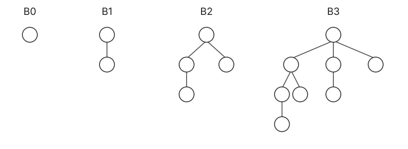
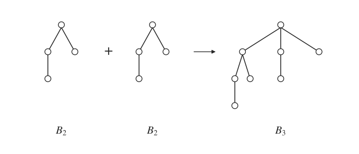
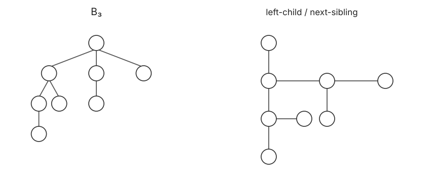

# 二项堆 · Binomial Heap

## 1. 二项树 · Binomial Tree

$B_0$ 为单节点；两个 $B_{k-1}$ 合并，将其中一棵的根作为另一棵根的孩子，得到 $B_k$。



$$
\operatorname{height}(B_k)=k,\qquad
\operatorname{fanout}(\mathrm{root})=k,\qquad
|B_k|=2^k.
$$

$B_k$ 的根下面依次挂着 $B_{k-1},B_{k-2},\ldots,B_0$，这也是 delmin 后能直接拆成二项堆的原因。

$B_k$ 中深度为 $d$ 的节点数（$0\le d\le k$）：

$$
\binom{k-1}{d}+\binom{k-1}{d-1}=\binom kd.
$$

## 2. 二项堆 · Binomial Heap

二项堆是满足以下条件的森林：

1. 各二项树的高度互不相同。
2. 每棵树均满足堆序（heap order）。

对应节点数 $n$ 的二进制表示，每个阶至多一棵树：

$$
n=\sum_k b_k2^k,\quad b_k\in\{0,1\},
\qquad
\#\mathrm{trees}\le\lfloor\log_2n\rfloor+1=O(\log n).
$$

**Findmin**：扫描各树根，$O(\log n)$；维护一个 pointer 指向最小根，可为 $O(1)$。

## 3. 插入与合并

**Insert**：create $B_0(x)$，从最低阶开始，不断合并同阶树。

**Merge**：类似二进制加法 $(\cdot)_2+(\cdot)_2$。从最低阶到最高阶扫描，若同阶有 $2$ 或 $3$ 棵树，选两棵 combine 为下一阶。

每次 combine 将较大根接为较小根的孩子，耗时 $O(1)$；总计 $O(\log n)$。



**伪代码实现如下**

```text
insert(x):
1. create B0(x)
2. i = 0
3. while two trees of order i exist
4.     combine them into B(i + 1)
5.     i = i + 1

merge(H1, H2):
1. for i = 0 to the highest order, including carry
2.     if 2 or 3 trees of order i exist
3.         pick 2 of them and combine them into B(i + 1)
```

## 4. 删除最小值、减小键值与删除

**Delmin**：最小根在 $B_k$ 中。删除该根，得到：

$$
H'=H-B_k,\qquad H''=\{B_{k-1},B_{k-2},\ldots,B_0\},
$$

再 $\operatorname{merge}(H',H'')$，耗时 $O(\log n)$。

**Decreasekey**：减小 key 后，在所在树中向上调整。树高 $k=O(\log N)$。

**Delete(x)**：$\operatorname{decreasekey}(x,-\infty)+\operatorname{delmin}$，耗时 $O(\log n)$。

实现采用 **左孩子—右兄弟 · Left-child / Next-sibling** 表示：一个指针指向第一个孩子，另一个指向下一个兄弟。合并同阶树时，只需把较大根接到较小根的孩子链表中，无需遍历整棵树。



## 5. 插入的摊还分析

连续 $N$ 次插入，不必每次都付出 $O(\log n)$。设一次插入发生 $t$ 次 combine：

$$
\operatorname{actual\ cost}=O(1)+ct,\qquad
\Phi(H)=c\cdot\#\mathrm{binomial\ trees\ in\ }H.
$$

每次 combine 使树数减 $1$：

$$
\Delta\Phi=c(1-t),\qquad
\operatorname{amortized\ cost}=O(1)+ct+c(1-t)=O(1).
$$

这里不能把每次 insert 的最坏 $O(\log n)$ 直接累加；combine 的总代价会被树数势能下降抵消。空堆初始势能为 $0$，过程中势能始终非负。

因此 $N$ 次插入的总代价为 $O(N)$。

## 6. 堆的复杂度对比

| 操作 | Binary | Leftist | Skew | Binomial | Fibonacci |
| :--- | :--- | :--- | :--- | :--- | :--- |
| Make-heap | $O(n)$ | $O(n)$ | $O(n\log n)$ | $O(n)$ | $O(n)$ |
| Findmin | $O(1)$ | $O(1)$ | $O(1)$ | $O(1)$* | $O(1)$ |
| Insert | $O(\log n)$ | $O(\log n)$ | $O(\log n)$ | $O(\log n)$** | $O(1)$ |
| Delmin | $O(\log n)$ | $O(\log n)$ | $O(\log n)$ | $O(\log n)$ | $O(\log n)$ |
| Merge | $O(n)$ | $O(\log n)$ | $O(\log n)$ | $O(\log n)$ | $O(1)$ |
| Delete | $O(\log n)$ | $O(\log n)$ | — | $O(\log n)$ | $O(\log n)$ |
| Decreasekey | $O(\log n)$ | $O(\log n)$ | — | $O(\log n)$ | $O(1)$ |

Skew、Fibonacci 为摊还界；— 为本节实现不支持。

\* Binomial 的 $O(1)$ findmin 需维护最小根指针。

\*\* Binomial insert 的单次最坏界为 $O(\log n)$，摊还为 $O(1)$。
