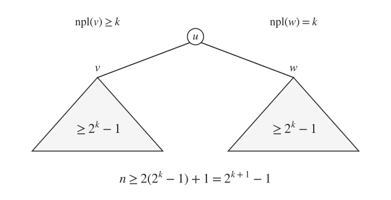
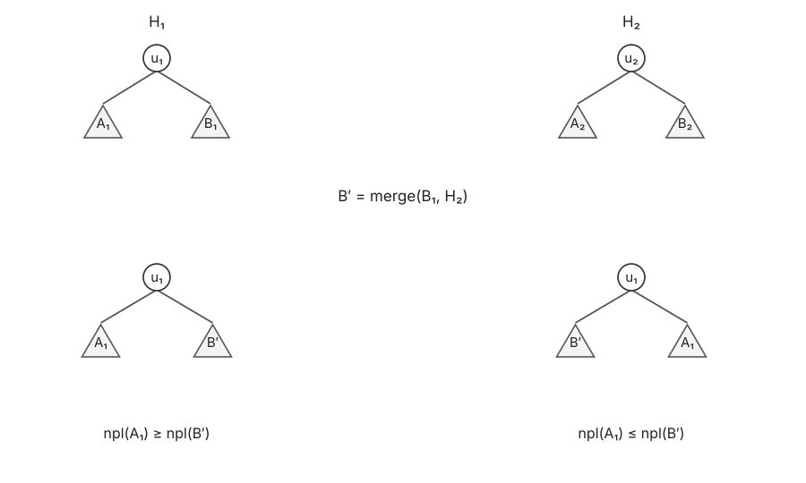
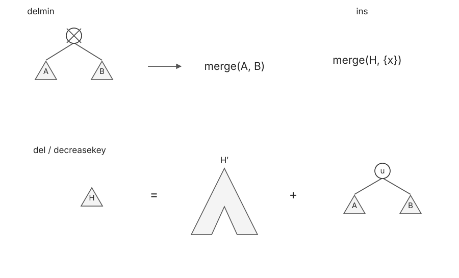

# 左式堆 · Leftist Heap

## 1. 性质与右路径

1. 最小堆性质（min-heap property）：父节点的 key 不大于孩子。
2. 左式性质（leftist property）：$\operatorname{npl}(u.\mathrm{left})\ge\operatorname{npl}(u.\mathrm{right})$。

Null path length（npl）：从节点走到 NULL 的最短路径长度。取 $\operatorname{npl}(\mathrm{NULL})=0$，则叶节点的 npl 为 $1$。左式性质不要求左子树的节点数更多。

左式堆只要求二叉树与 heap order，**不要求完全二叉树**。

$$
\operatorname{npl}(u)=1+\min\{\operatorname{npl}(u.\mathrm{left}),\operatorname{npl}(u.\mathrm{right})\}
=1+\operatorname{npl}(u.\mathrm{right}).
$$

因此右路径恰好是一条到 NULL 的最短路径。

右路径：从 root 开始一直沿右孩子走到 NULL。

**Lemma**：$n$ 个节点的左式堆，其右路径的节点数 $r$ 满足：

$$
n\ge 2^r-1\quad\Rightarrow\quad r\le\log_2(n+1).
$$

**Base case**：$r=1$，$n\ge 1=2^1-1$。

**Inductive hypothesis**：右路径长度为 $k$ 时，至少有 $2^k-1$ 个节点。

**Inductive step**：$r=k+1$。右子树的右路径长度为 $k$，左子树的 npl 不小于右子树：



$$
n\ge 2(2^k-1)+1=2^{k+1}-1.
$$

## 2. 合并 · Merge

不妨设 $u_1.\mathrm{val}\le u_2.\mathrm{val}$。保留 $u_1$ 为根，将其右子树 $B_1$ 与 $H_2$ 合并：

$$
B'=\operatorname{merge}(B_1,H_2).
$$

比较 $A_1$、$B'$ 的 npl，必要时交换左右子树，再更新 $u_1$ 的 npl。



递归每次沿其中一个堆的右路径前进：

$$
\#\mathrm{levels}\le r_1+r_2=O(\log n).
$$

**伪代码实现如下**

```text
merge(H1, H2):
1.  if u1 == NULL
2.      return H2
3.  if u2 == NULL
4.      return H1
5.  ensure u1.val <= u2.val
6.  B' = merge(B1, H2)
7.  if npl(A1.root) <= npl(B'.root)
8.      u1.left = B', u1.right = A1
9.  else
10.     u1.left = A1, u1.right = B'
11. update npl(u1)
12. return tree rooted at u1
```

## 3. 其他操作

**Delmin**：删除根，将左右子树 $A,B$ 合并。

**Insert**：将新节点看作单节点堆，与原堆合并。

**Delete(u)**：取出 $u$，用 $\operatorname{merge}(A,B)$ 替代原位置，再向上维护左式性质。

**Decreasekey(u)**：将 $T_u$ 切出，减小 $u$ 的 key，维护原堆后再 merge。



### 3.1 向上维护

沿祖先 $u_1,u_2,\ldots$ 更新。若左右 npl 顺序不满足，交换；更新当前 npl。

> **关键**
>
> 当前节点的 npl 不再改变，就可以停止，祖先无需继续更新。

将当前祖先记为 $u_i$、刚更新的孩子记为 $u_{i-1}$、另一个孩子记为 $v$：

- 若 $u_{i-1}$ 在右侧，直接重新比较左右 npl、更新当前 npl。
- 若 $u_{i-1}$ 在左侧且新的 npl 小于 $\operatorname{npl}(v)$，交换左右子树后继续更新。
- 若当前 npl 与原来相同，则上层看到的 npl 没有变化，立即停止。

设最后一个 npl 发生变化的节点为 $u_k$，变化继续传播时，每向上一层 npl 至少增加 $1$：

$$
k-1\le\operatorname{npl}(u_k)\le\log_2(N+1).
$$

发生 npl 变化的节点链可按 npl 递增来计数，更新次数为 $O(\log N)$。

因此 delmin / insert / delete / decreasekey 均为 $O(\log N)$。

### 3.2 建堆 · Build

建一个完全二叉的最小堆即可满足左式性质：

$$
\operatorname{Build}=O(N).
$$
