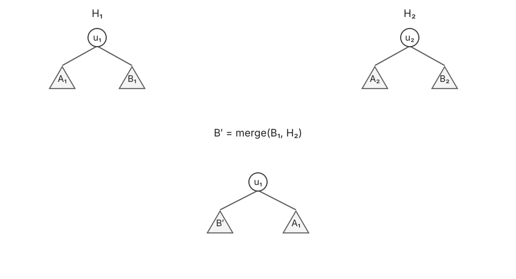

# 斜堆 · Skew Heap

## 1. 合并 · Merge

与左式堆类似，但不记录 npl。合并后直接交换左右子树。

不妨设 $u_1.\mathrm{val}\le u_2.\mathrm{val}$，先求 $B'=\operatorname{merge}(B_1,H_2)$，再返回以 $u_1$ 为根、左右子树分别为 $B',A_1$ 的堆。



**伪代码实现如下**

```text
merge(H1, H2):
1. if u1 == NULL
2.     return H2
3. if u2 == NULL
4.     return H1
5. ensure u1.val <= u2.val
6. B' = merge(B1, H2)
7. u1.left = B'
8. u1.right = A1
9. return tree rooted at u1
```

Ins、delmin 转为 merge；本节实现不支持任意节点的 del、decreasekey。

## 2. 摊还分析

给定节点 $u\in H$，令：

$$
u\text{ is heavy}\iff |T_{u.\mathrm{right}}|>\frac{|T_u|}{2},
\qquad
\Phi(H)=c\cdot\#\mathrm{heavy\ nodes\ in\ }H.
$$

否则为 light。heavy 也可取 $|T_{u.\mathrm{right}}|\ge |T_u|/2$ 的约定；等号边界放在哪一类不影响对数级摊还结论。

设两堆右路径上 light、heavy 节点数分别为 $\ell,h$。

### 2.1 合并的摊还代价

未被合并访问的节点，其子树规模与左右孩子均不改变，heavy / light 状态也不变。只需统计两条右路径上的变化。

右路径上的 heavy 节点交换后变为 light；light 节点至多各增加一个 heavy：

$$
\operatorname{actual\ cost}\le c(\ell+h),\qquad
\Delta\Phi\le c(\ell-h).
$$

有：

$$
\operatorname{amortized\ cost}
=\operatorname{actual\ cost}+\Delta\Phi
\le c(\ell+h)+c(\ell-h)=2c\ell=O(\log n).
$$

> **关键**
>
> 右路径上每经过一个 light 节点，子树规模至少减半，因此 $\ell=O(\log n)$。

### 2.2 删除最小值的摊还代价

删除根后合并左右子树，删除根不会增加势能：

$$
\operatorname{amortized\ cost}\le O(1)+2c\ell=O(\log n).
$$

单次 merge 可能花费 $\Theta(n)$；上述 $O(\log n)$ 为摊还界。
